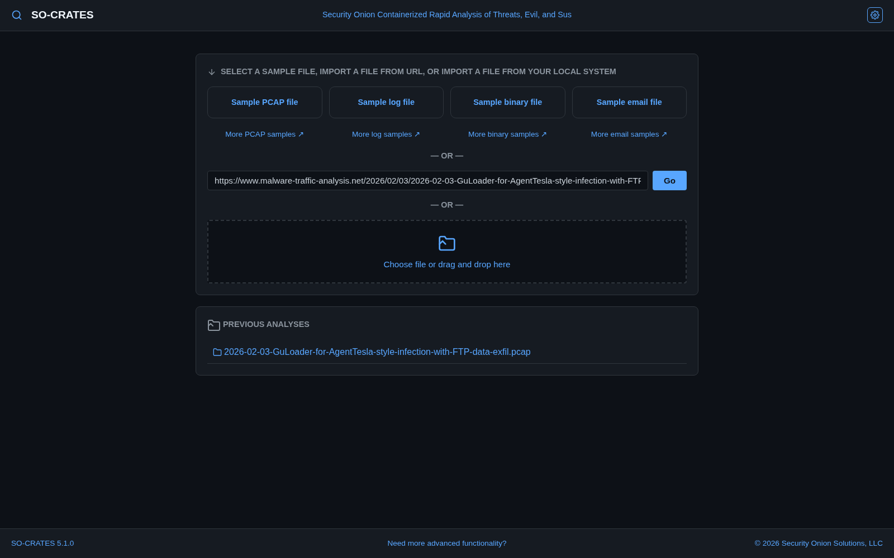

# Analyzing Files

Every analysis starts on the main screen, which has the sample cards, the Load from URL box, the upload area and, below them, your previous analyses:

1. **Upload a file** - click **Choose file or drag and drop here** (or drop a file on it) and select a `.pcap`, `.pcapng`, `.cap`, `.trace`, `.evtx`, `.json`, `.jsonl`, `.csv`, `.xml`, `.log`, `.eml`, or any other file type (or a `.zip` containing one). File types are auto-detected:
    - **PCAP** files → Suricata network analysis, with tshark adding the protocols Suricata doesn't parse
    - **Log files** (`.evtx`, `.json`, `.jsonl`, `.csv`, `.xml`, `.log`) → Zircolite Sigma rule detection
    - **Email messages** (`.eml`, or any file that starts with an email's headers) → email analysis of headers, links, and attachments, with each attachment YARA-scanned. A message over 100 MB gets YARA binary scanning instead, and anything past the per-message limits (100 attachments, 1,000 links, 50 forwarded messages, 5 levels of forwarding) is reported as a warning on the email
    - **Other files** → YARA binary scanning
2. **Try a sample** - the main screen's sample cards load a PCAP, log, binary, or email file. All four are built into SO-CRATES, so they work with no internet access, and together they tell one story - see [The Sample Story](sample-story.md)
3. **Load from URL** - paste a URL to a file and press **Enter** (or click **Go**). The URL box is pre-filled with a link to a real infection's traffic on malware-traffic-analysis.net - click **Go** to try it (this one needs internet access). Password-protected zips from `malware-traffic-analysis.net` are auto-decrypted using the date-based password format
4. **Reopen a previous analysis** - previously analyzed files are listed on the main screen
5. **Reanalyze or delete an open analysis** - once an analysis is open, its header (next to the notes icon) has reanalyze and delete icons - reanalyze deletes the existing results and re-runs the pipeline in place; delete removes the analysis and returns to the main screen (not while it's still being analyzed - wait for it to finish). To delete every previous analysis at once, use the Danger Zone section in Settings ([Gear Menu](keyboard-and-menus.md#gear-menu) → Settings) instead; it leaves any still being analyzed, and says how many

## Custom Suricata Rules

You can add your own Suricata rules: to test one you just wrote against a capture, or to run private IOC rules, without leaving SO-CRATES or going online.

1. Open **Rules** from the [Gear Menu](keyboard-and-menus.md#gear-menu) and click **(Enable/Disable Rulesets)**. **Custom rules** is the last row, under the curated sources
2. Click **Add Rules** (**Edit Rules** once you have some). Paste your rules, one per line, or click **Load a file...** to put a `.rules` file in the editor. Nothing is sent until you click **Save**
3. Every rule needs a `sid` between **1,000,000 and 1,999,999**, the range conventionally kept for local rules. Each SID can be used once
4. Click **Save**. Every rule is checked first, and the rules are saved only if they all pass. Otherwise nothing changes, your text stays in the editor, and each problem is listed with its line number (click one to select that line):
    - more than 1 MB of text or 5,000 rules
    - a rule using `dataset`, `datarep`, `iprep` or Lua (`lua`, `luajit`, `luaxform`) - these can read or write files or run a script, so custom rules can't use them
    - a SID outside 1,000,000-1,999,999, missing, or used twice
    - anything Suricata itself rejects, in Suricata's own words (an unknown keyword, a bad `pcre`...)

Saved rules are on straight away, and apply to every capture analyzed from then on. To run them on a capture that's already open, use **Reanalyze this one** in the message after saving, or the analysis's reanalyze icon. Their alerts show the ruleset **Local / Custom Rules** in Network Alerts.

The switch beside **Custom rules** turns them off and on like any other source, kept for later while off - click **Update** for the change to take effect. Save an empty editor to delete them. They're kept in your data folder (`/data` in the container), so they survive a restart and an image upgrade.

Custom rules belong to the whole server: on an instance several people use, everyone's analyses run them. Whoever runs a shared instance can turn adding them off with `ALLOW_CUSTOM_RULES=false` (see [Docker](../installation/docker.md#shared-instances)).
