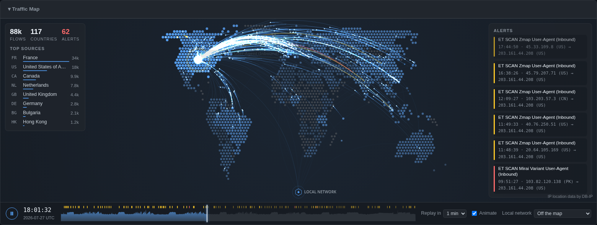

# Exploring Results

## Navigate Results

After analysis completes, the UI displays different views depending on the file type. If part of the analysis went wrong without failing it - a YARA scan that failed or timed out, so File Alerts may be missing - a line above the results says so, and why.

**For PCAP files:**

- **Stats Grid** - clickable cards showing event counts by type (Alerts, DNS, HTTP, TLS, Flows, etc.). If you've enabled "Show protocol-anomaly noise alerts" (Gear Menu → Rules), those alerts get their own **Decoder Alerts** card instead of mixing into Network Alerts. A **Findings** card gathers what the protocol records show is worth a look (see [Findings](#findings) below), and a **DNS Heuristics** card appears whenever any domain in the capture trips a scoring flag (see [DNS Heuristics](#dns-heuristics)). Every card is the same size. A PCAP analysis's cards come in three sections, each a panel with its heading on top: **Triage** (the alert cards, Findings, DNS Heuristics, Acknowledged Alerts and All Events - the way into everything), **Protocol records** (each type of record), and **Connections** (Flows, then tshark's connection cards, then Probed Only). The panels share rows, each as wide as its cards, so a small section sits beside the next one rather than leaving its row empty; hover a heading for what its section holds. A capture whose cards all fall in one section shows no headings. Click a heading (or Tab to it and press Enter) to collapse its section to the heading alone, which then shows how many cards it holds - the arrow keys skip a collapsed section's cards. Your choice is remembered for each section, in this browser, for every analysis; until you make one, **Connections** starts collapsed when it has more than 12 cards. Opening a tab whose card is in a collapsed section - from a pivot, the Command Palette or DNS Heuristics - opens that section for the moment.
- **Sankey Diagram** - expand the collapsible heading to visualize network flow relationships (Source IP → Dest IP → Dest Port)
- **Traffic Map** - expand the collapsible heading to replay the capture's flows and alerts on a world map, by country - see [Traffic Map](#traffic-map) below
- **Aggregation Tables** - frequency counts for each column; click a value to open the [pivot menu](filtering-and-drilldown.md#pivot-menu). Each table pages through its values with Prev/Next instead of growing the page, at a size (10/25/50/100) set by the "Items per page" selector, which applies to every table in the section and persists across sessions
- **Data Table** - sortable table with expandable detail rows showing full event JSON, ASCII transcripts, and hexdumps. Every row's flow carries a community ID, and a TLS row's detail panel includes JA3/JA3S/JA4 fingerprints whenever present - both computed by Suricata automatically, no configuration needed
- **Search** - full-text search across all event data using SQLite FTS5 (falls back to `LIKE` if FTS5 is unavailable)
- **Filtering** - filter via the pivot menu's Include/Exclude/Only actions on any table cell or aggregation value; filter chips show active filters; filters persist across all tabs and the Sankey diagram

### Traffic Map

The **Traffic Map** heading, under the Sankey Diagram, opens a world map that replays the capture: each flow flies from the country it came from to the one it went to, in the order the flows started, and each alert flies in its severity's color, with its signature shown where it lands. Countries light up as they send or receive traffic, and a faint line stays behind on every route taken, so the map shows where the capture has been even between flows. Nothing is fetched or animated until you open it.

- **Timeline** - the strip under the map shows how busy each moment of the capture was, with a tick for each alert. Click or drag it to jump; the clock beside it shows the capture's time (UTC) at that point. **Replay in** sets how long the whole capture takes to play: 20 seconds, 1 minute or 3 minutes.
- **Top sources** (or **Top destinations**, when everything comes from your own network) ranks the countries so far, and **Alerts** lists the latest alerts with their addresses and countries.
- **Filter by country** - click a country on the map, or in the Top list, to filter the whole analysis to traffic to or from it: a `country:FR` search term is added, so every tab, count, table and the map itself narrow to it, like any search. Click it again (or remove its chip) to undo. Two countries filter to the traffic between them. You can also type a term yourself: `country:` and an ISO country code, `country:LAN` for addresses that don't route on the internet (private, loopback, link-local, multicast), or `country:??` for those with no known country.
- **Local network** - private addresses have no country, so they gather at a **Local network** point below the map. If you know where your network is, pick its country in the **Local network** menu to place it there instead.
- **Animate** - turn it off for a still map with every route at once, weighted by its traffic. It starts off if your system asks for reduced motion.

Locations are country-level, from DB-IP's free IP to Country Lite data, which is included in the container image (a local development run without it can place only local network traffic). A country is where an address is registered, which for a cloud or CDN address may not be where the machine is. Places too small to have a shape on the map (Singapore, Hong Kong, Malta...) are drawn as a point.

### Protocols from tshark

Suricata doesn't parse every protocol. Alongside it, SO-CRATES runs tshark (Wireshark's command-line engine) over the capture, and the protocols Suricata doesn't parse join the analysis's results, each card marked with a dot in its corner - the note at the right end of the **Protocol records** heading starts with the same dot, and says how many protocols tshark added ("● tshark parsed 8 additional protocols in 43s" - the count is of the card types tshark added, the connection cards included):

- **Records** for NBNS and LLMNR (Windows name resolution and registration), SSDP (UPnP device discovery) and S7comm (Siemens PLC reads, writes and control) - one per transaction, with their own columns and aggregations - and for **Telnet**, one per session: the server's banner (which usually names the device - the **Banner** aggregation lists the devices answering Telnet), the user name and password typed at its login prompts - the last attempt's, with how many failed before it (**Earlier Failed Logins**) - whether it said that login failed, and the commands typed after. A secret typed at a later prompt (a PIN, an enable password) is kept nowhere, nor listed as a command. Telnet sends everything in plain text, so the password is the one in the capture - the same one the session's ASCII transcript shows. (Suricata recognizes Telnet but logs nothing about it.)
- **IEC 104** (IEC 60870-5-104, the telecontrol protocol between a power grid's control centre and its substations), as two record types. **IEC 104** has one record per control action - a command (switch on or off, raise or lower a tap changer), a set point, an interrogation, a clock synchronization, a read, a reset, a parameter or a file transfer - with the station (common address) and object address (IOA) it's for, the value sent, and its **Result**: *confirmed*, *negative* (refused), *confirmed, terminated* (finished), *no confirmation*, or *(request not seen)* for a reply whose request is before the capture started. **IEC 104 Points** has one record per monitored point on each connection - a busy link sends hundreds of thousands of measurements, so they're summarized rather than listed: the point's type, how many updates it sent and why (spontaneous, periodic, answering an interrogation), and its last value. The **Command** and **Result** aggregations show who's being controlled and how it went.
- **BACnet** (building automation - HVAC, lighting, access control - over BACnet/IP or straight over Ethernet), as three record types. **BACnet** has one record per action: a write (the object, property and value written), a file write, a subscription, a **reinitializeDevice** (restart) or **deviceCommunicationControl** (silencing a device) with the state asked for and the password sent - devices protect these with a password, and the **Password** aggregation lists the ones tried - and its **Result**: *ok*, an error (*services: password-failure* is a wrong password), *rejected*, *aborted* or *no reply*. Event notifications, time syncs and the like are actions too; Who-Is and Who-Has discovery questions are one record per sender and question, with how many times it was asked. **BACnet Properties** summarizes polling - one record per object and property read (or reported by change-of-value notifications) on each connection, with how many times, how many failed, and the last value when the reply carried exactly one. **BACnet Devices** has one record per device announcing itself (I-Am): its device number and vendor.
- **OPC UA** (OPC UA binary, `opc.tcp` on port 4840 - industrial automation's client/server protocol), as two record types. **OPC UA** has one record per connection: the **Endpoint** the client asked for, the **Security** policy (*None* means unsigned and unencrypted) and mode, the client **Application** and session name, the user token (anonymous, username, certificate) with the **User** - and the **Password** when the client sent it unencrypted, as it often does with security policy None - whether the session's **Activation** worked (*BadUserAccessDenied* is a refused login), how many times each service was called, and the errors. With *SignAndEncrypt* only the connection's opening can be read; the record counts the encrypted messages. **OPC UA Actions** has one record per change the client asked for - a **Write** (the node, attribute and value), a **Call** (the method, the object it's on and its arguments - but not the values of a user-management method's, such as ChangePassword or AddUser, which can carry a password; the record says how many there were), **AddNodes**, **DeleteNodes**, or a reference added or deleted - with that operation's own **Result** (a response can be *Good* while the operation in it failed). OPC UA on another port than 4840 isn't recognized, and shows as a plain TCP connection.
- **MMS** (Manufacturing Message Specification, TCP port 102 - what IEC 61850 substations use between SCADA and their protection relays and bay controllers, and what ICCP/TASE.2 links between control centres run on), as two record types. **MMS** has one record per connection: whether the association was **Initiate**d (*accepted*, or the error), the logical devices (**Domains**) the client touched, the server's **Vendor**, **Model** and revision when the client asked it to identify itself, how many times each service was called (mostly reads and browsing, on a SCADA link), the reports the server sent unasked, and the errors. **MMS Actions** has one record per change the client asked for - a **write** (the variable and the **Value** written), a program **start**, **stop**, **resume**, **reset** or **kill**, a domain download or delete, a semaphore taken or given back (**takeControl**, **relinquishControl**), a definition added or deleted - with its own **Result** (*success*, the reason one variable's write failed, such as *object-access-denied*, or the error the server answered with). A write to an IEC 61850 controllable object's **Oper**, **SBO**/**SBOw** or **Cancel** - `XCBR1$CO$Pos$Oper` operates a circuit breaker - is named in **Control** as *operate*, *select* or *cancel*. The login password an association can carry isn't kept.
- **Omron FINS** and **Omron FINS Actions** (Omron's PLC protocol, UDP or TCP 9600 - Suricata doesn't parse it). A FINS record per connection (FINS/TCP) or UDP exchange: the **Commands** sent, the PLC's **Model** and **Version** if it answered a Controller Data Read, the destination and source **Node**, whether it **Answered**, and its **Errors** (FINS end codes, by name). An action record per command that changes or controls the PLC - a memory area written or filled, a parameter or program area written or cleared, a **Mode** change (Run in PROGRAM, MONITOR or RUN mode, or Stop), a forced set or reset, the clock written, an access right forced, files written or deleted, a memory card formatted - with its **Area**, **Address**, the **Data** written (its first 32 bytes) and its **Result**. A program area's protection password travels in the clear, and is shown. Reads - an HMI's polling - are counted on the connection, not recorded one by one. FINS has no login. On an internet-facing sensor, most FINS records are scanners' Controller Data Reads, from source node 99.
- **C37.118** (IEEE C37.118 synchrophasors, TCP 4712 or UDP 4713 - Suricata doesn't parse it): phasor measurement units (PMUs) in substations streaming the grid's voltages, currents and frequency, time-stamped by GPS, to a phasor data concentrator (PDC). One record per stream: the **Commands** the PDC sent (send header, send configuration, data on, data off), the frames of each type (data, header, configuration, command), the **Stream ID**, the PMU's header text, each PMU in its configuration - its **Stations** name, ID, phasor and analog channel names, digital status labels and nominal frequency - the **Data Rate**, the **Data Frames**, and how many of them said the PMU had lost its time sync (**Not Synced**), triggered, or changed configuration. C37.118 has no login.
- **EtherCAT** (the fieldbus inside machines - drives, I/O modules - on EtherType 0x88A4, or UDP 34980 when routed; Suricata doesn't parse it). One record per master: the datagram **Commands** it sent, how many **Slaves** answered its broadcast read, the **State Requests** it made through the slaves' AL Control register (INIT, PRE-OP, SAFE-OP, OP, BOOT - and whether to every slave at once), **EEPROM Writes** (a slave's identity and configuration rewritten), the mailbox traffic by protocol, the **FoE** files read or written (how firmware goes onto a slave) and the CoE objects addressed, and whether anything **Answered**. A capture sees each frame twice - as the master sent it, and back from the slaves with its source MAC's locally administered bit set - and a mailbox's frames as a flow of their own: they're one record, on the master's flow, each command counted once. On an internet-facing sensor, EtherCAT is scanners' broadcast reads over UDP, looking for a fieldbus reachable from the internet.
- **HART-IP** and **HART-IP Actions** (HART over IP, UDP or TCP 5094 - Suricata doesn't parse it). HART is the protocol of 4-20 mA field instruments - pressure, flow, level, temperature transmitters, valve positioners - and HART-IP carries it to and from gateways and asset managers. A HART-IP record per session: the **Host Type** (primary or secondary master), whether the **Session** was accepted, the **Commands** sent (HART command names), whether it **Answered**, its errors, and each device that answered: its manufacturer, device type and ID, revision, **Tags**, descriptor, message, primary variable and loop current. An action record per command that changes or commands a device - its tag or message written, its range, zero, damping or units set, its loop current fixed or trimmed, a device variable written, a reset or self test - with the **Device** (its long address), the **Data** sent (a fixed current in mA, a tag as the device echoes it) and its **Result**. HART-IP 1 has no login. A gateway that answers a UDP Session Initiate from another port and carries on there is one session, on the initiate's flow.
- **PROFINET DCP** (PROFINET's Discovery and Configuration Protocol, straight over Ethernet - how engineering tools and IO controllers find PROFINET devices and assign their names and addresses), as two record types. **PROFINET DCP** has one record per action: an **Identify** query - for every device (*all*) or one station name - with how many times it was sent and how many devices answered; a **Set**, with the **Changes** asked for (*IP address*, *station name*, *DHCP*, *reset to factory*, *reset factory settings*, or *signal* - flashing the device's LED to find it), the **Station Name** or **IP** address, mask and gateway set, whether permanently or until the device restarts, and the device's **Result** (*ok*, or why it refused, such as *not possible (in operation)*); and a **Get**. **PROFINET Devices** has one record per device that described itself - answering an Identify or a Get, or announcing itself with Hello: its **Station Name**, **Device Type**, **Vendor ID** and **Device ID**, **Role** (IO device, IO controller...), MAC, and its **IP** address, mask and gateway. DCP has no authentication: a Set from anywhere on the segment renames, readdresses or resets a device, and its controller loses it. PROFINET's cyclic I/O stays a connection card.
- **MongoDB** (TCP 27017 - Suricata doesn't parse it), as two record types. **MongoDB** has one record per connection: the client's **Driver** (PyMongo, mgo, the MongoDB shell...), application, OS and platform, from the hello it opens with; the **User** and mechanism of a login (SCRAM, PLAIN, X.509, the old MONGODB-CR) and whether the **Login** worked - never a password, key or proof; how many times it sent each command, the **Databases** it touched, the **Server Version** and the databases the server listed when asked, whether the server **Answered** at all, and the errors. On an internet-facing sensor most are scanners' probes - isMaster, buildinfo, listDatabases - nobody answered; the **Driver** aggregation shows which tools sent them. A connection whose commands past the handshake were answered with no login is marked **Unauthenticated**. **MongoDB Actions** has one record per change: documents inserted (with how many, and the first one's start - an attacker's ransom note is usually the one document), updated or deleted (with the first filter), a collection or database dropped, an index or collection created, a user or role created, changed or granted (with its roles - never its password), a setting changed, or the server shut down - with its **Result** and how many documents it affected.
- **Remote Shell** - the BSD remote shells, **rsh** (TCP 514), **rlogin** (513) and **rexec** (512), all in plain text, which Suricata doesn't parse. One record per connection: the **Service**, the remote **User** (and, for rsh and rlogin, the **Local User** the client claims to be - they trust its word), the **Command** run (rsh, rexec) or the terminal (rlogin), the **Password** (rexec sends it; rlogin's is the one typed at the server's prompt, if it asked), and the **Result**: *accepted*, *refused* with the server's reason, or *no response*. An accepted rsh or rexec keeps the start of the command's output; an rlogin session keeps the lines typed, read like Telnet's. A connection that opens with something else - a scanner's HTTP request or RPC packet - is kept as a **Probe**, with the service's answer (often its error), which shows the service is listening. Suricata names a probe's flow by what was sent (HTTP), and then that record isn't added.
- **OpenVPN** (UDP or TCP 1194 - Suricata doesn't parse it). One record per connection: its **Stage** - *client reset only* (nothing answered), *server answered*, *TLS handshake*, or *established* (data both ways); the protocol **Version**; how the control channel is protected (**Protection**: *tls-auth*'s HMAC, *tls-crypt-v2*, or *none*); how many times the client started over (**Resets** - a client that can't get through keeps retrying, each time with a new session ID); the TLS handshake run inside the control channel - the server's certificate (**Subject**, issuer, validity, fingerprint), a client certificate if one was sent, the cipher suite, the client's JA4 and SNI - unless tls-crypt hides it; and the data packets each way (**Data Pkts →**, **Data Pkts ←**), with how many keys the data used when it was renegotiated. On an internet-facing sensor most are scanners' single resets; a host of yours retrying a server that never answers is a VPN set up to reach out, and blocked. OpenVPN on another port than 1194 isn't recognized.
- **WireGuard** (UDP, any port - Suricata doesn't parse it). One record per connection: its **Stage** - *initiation only* (nothing answered), *handshake*, *established* (data both ways), or *data only* (a tunnel already up when the capture started, its data one way); the handshakes started (**Initiations** - either peer starts one, every two minutes while the tunnel's in use) and answered (**Handshakes**), the **Unanswered** ones, cookie replies (a peer under load), and the data packets each way (**Data Pkts →**, **Data Pkts ←**) with the **Keepalives** among them. Everything past the handshake's start is encrypted, so that's all that shows - unless the capture carries the tunnel's keys (a pcapng with decryption secrets), when tshark decrypts it: then both peers' public keys show, and the packets inside are flows of their own, with a WireGuard tunnel record. tshark recognizes WireGuard by its messages' shape, which a stray packet can have too: a connection with no handshake counts only when its data goes to the same receiver more than once.
- **Oracle TNS** and **Oracle SQL** (Oracle's database protocol, TCP 1521 - Suricata doesn't parse it). An **Oracle TNS** record per connection: the **Service** (service name or SID) the client asked the listener for, with its program, host and OS user; the listener's **Result** - *accepted*, *refused* (with its error: ORA-12505 or ORA-12514 is a SID or service it doesn't know, which is how SIDs are guessed; the listener's version too, when it gives it), or *redirected* (where to); then the login - the **DB User**, the client's **OS User**, **Program**, terminal, machine and process ID, and whether the **Login** succeeded (or its ORA- error) - the database, instance and server host the server names, its banner, how many **Statements** were sent and the ORA- errors they got. A connection that sends the listener a command instead (lsnrctl's status, version, stop...) has the **Listener Command** and the listener's answer. An **Oracle SQL** record per distinct statement on a connection: its **Verb** (*SELECT*, *INSERT*, *CREATE USER*, *DROP TABLE*...), the **Statement** itself, its **Result** (*ok*, or the ORA- error), and how many times it was sent (**Count**) - so an application repeating a query is one record. A password set with IDENTIFIED BY is masked in the statement and kept beside it. The login's password is encrypted, and isn't read. tshark recognizes TNS on port 1521 only, so a connection redirected to another port isn't followed. Native network encryption, when it's on, hides the login and the SQL - the record stops at the listener's answer.
- **MySQL** and **MySQL Statements** (MySQL and MariaDB, TCP 3306 - Suricata doesn't parse it). A **MySQL** record per connection: the **Server Version** from its greeting; the login - the **DB User**, the **Database**, the auth plugin, the **Client** (program, library and version, from the attributes it sends) and its OS, whether a password was sent at all, and whether the **Login** succeeded (or its error); how many **Statements** were sent and their errors; and **SSL** when the client asked for TLS first, which hides the login and everything after it. A **MySQL Statements** record per distinct statement: its **Verb**, the **Statement**, its **Result** (*ok*, or the error), rows affected, and how many times it was sent (**Count**). A password a statement sets (IDENTIFIED BY, SET PASSWORD) is masked in it and kept beside it; the login's own is a hash of a challenge, not the password.
- **SQL Server** and **SQL Server Statements** (Microsoft SQL Server's TDS, TCP 1433 - Suricata doesn't parse it). A **SQL Server** record per connection: the server's version and product, the **Encryption** the pre-login agreed - *none* (the login and its password in the clear: TDS only obfuscates it), *login only* (the usual: the login inside TLS, the SQL after it not), or *everything* - and, when the login shows, the **DB User**, their password, the **Database**, the **Application** and **Client Host** it named, the client library, and whether the **Login** succeeded (or its error); then the **Statements** and their errors. A **SQL Server Statements** record per distinct statement - a SQL batch, or an RPC call: sp_executesql's statement, or a stored procedure called by name (shown as EXEC) - with its **Verb**, **Result**, and **Count**; a password a statement sets (PASSWORD = ...) is masked in it and kept beside it.
- **Redis** and **Redis Commands** (Redis and its forks - Valkey, KeyDB - TCP 6379; Suricata doesn't parse it). A **Redis** record per connection: the **Auth** - *none* (commands answered with no password asked for), *required* (refused, NOAUTH), *failed* or *succeeded* - with the **DB User** and the password AUTH sent, in the clear; the **Commands** sent (with how many of each) and the first **Keys** they named; the server's name, **Server Version**, OS and role, from INFO or HELLO; the client library; whether it **Answered**, and its **Errors** by code; and **Inline** when the client sent plain-text commands, as netcat and telnet do. A **Redis Commands** record per distinct admin command - CONFIG, REPLICAOF (SLAVEOF), MODULE, ACL, EVAL and the other Lua commands, SAVE, FLUSHALL, SHUTDOWN, DEBUG, MIGRATE, CLIENT KILL... - with the **Command**, the full command (**Statement**), its **Result** (*ok*, the reply, or the error) and its **Count**; the settings a CONFIG SET changed, the master a REPLICAOF named and the module a MODULE LOAD loaded are kept beside it, and a password it sets (ACL SETUSER's >, CONFIG SET requirepass or masterauth, MIGRATE's AUTH) is masked in it and kept beside it. Those commands are how an open Redis is taken over: CONFIG SET dir and dbfilename, then SAVE, writes its database over a file of the attacker's choosing - authorized_keys, a cron file, a web root - with a key holding the payload; REPLICAOF a rogue server hands it the data and loads a module from it. RESP2 and RESP3 both, pipelined commands, and a message split across packets; a pushed message (a subscription's) answers nothing.
- **Zabbix** (Zabbix's agent and server protocol, TCP 10050 to an agent and 10051 to a server or proxy - Suricata doesn't parse it). Agents open a connection for each exchange, every few seconds, so one record per client, server and **Request** kind - *passive check* (a server or zabbix_get asking an agent for an item), *active checks* (an agent asking the server which items to collect), *agent data*, *sender data* (zabbix_sender), *proxy config*, *proxy data*, *command* (the frontend running a script)... - with how many **Connections** it took: the **Host** name, the **Version**, the item **Keys**, the **Commands** with their output - a system.run item asked for or configured, a remote command the server sent an active agent, a script - and whether each ran or was refused; the responses, the checks the agent didn't support, its errors, and a redirect to another server. system.run is remote code execution by design - an attacker's too, through a stolen or rogue server or an agent that allows it - and a proxy's configuration carries its hosts' IPMI and SNMP passwords, TLS pre-shared keys and secret macros: which kinds were sent (**Credentials Sent**, with how many) is kept, never their values. A message without Zabbix's header (a bare key from netcat, which today's agents refuse) isn't decoded, and Zabbix over TLS is Suricata's **TLS** record.
- **IRC** (TCP 6667 and the rest of IRC's 6660-6669 range - Suricata doesn't parse it). One record per connection: the **Nick** the server registered (or, without a welcome, the last one tried) and every nickname tried, the user and real name, whether the **Login** was *registered*, *failed* (a wrong server password), *refused*, or *not registered* (no answer either way), the **Server** (its **Network**, from its welcome, or its name), its version, the **Channels** joined and their topics, how many messages were **Sent** and **Received** - with the first fifty, who sent each and to whom - CTCP requests and replies (a client's VERSION), DCC file offers, the server's errors, and the client's QUIT. The server, operator and NickServ passwords and channel keys go in the clear and are kept in their own fields (NickServ's masked in the message). IRC is still how some botnets take orders, so a message or topic that reads as a bot's command - !, ., @ or $ and a verb bots use: !download, !ddos.syn, .scan, @update... - is listed apart (**Bot Commands**), and a nickname shaped like a bot's (USA|83621, [DEU|W10]48213) is flagged. IRC on another port isn't decoded. A client that opens with a server password reads to Suricata as FTP, and it logs FTP records of the IRC commands; the IRC record is kept on those connections all the same.
- **memcached** (TCP or UDP 11211 - Suricata doesn't parse it). One record per connection or UDP exchange: the **Commands** sent (with how many of each) and the first **Keys** they named, what **stats** were asked for, the **Server Version** the server gave, whether it **Answered**, its errors and misses, and the bytes each way (**Req Bytes**, **Resp Bytes**) - over UDP, the **Amplification** too: how many times the request's size came back. memcached has no login (but the binary protocol's rarely used SASL), and its UDP port answered anyone - the amplifier of the 2018 attacks, a request's source address forged so the reply hits the victim. On an internet-facing sensor most records are scanners' unanswered stats requests, looking for one. Text and binary protocol both; a stored value is skipped, never read as commands, and random bytes sent to the port make no record.
- **RakNet** (UDP, 19132 and others - the transport of Minecraft Bedrock and other games; Suricata doesn't parse it). One record per flow: the **Messages** exchanged (Unconnected Ping and Pong, the Open Connection requests and replies), whether the server **Answered**, whether a connection opened (**Connected**), the server's advertisement from its pong - for Bedrock, its **Edition**, **MOTD**, **Game Version**, **Players** of the maximum, level and game mode - the GUIDs, the MTU, and the connected datagrams each way. A record needs RakNet's magic in an offline message: random bytes sent to port 19132 make none. On an internet-facing sensor nearly all are scanners' unanswered pings and connection requests, looking for game servers to list or to use as reflectors.
- **TACACS+** (TCP 49 - Suricata doesn't parse it): network devices asking their TACACS+ server whether a user may log in or run a command, and telling it what was done. One record per session - an authentication, authorization or accounting exchange; one connection can carry many. Its **Type**, whether it was **Encrypted**, how many packets and whether the server answered. Bodies are normally encrypted with a key the devices and the server share, so that's all most records show. A body sent unencrypted - a flag RFC 8907 says must never be used in production - shows the rest: the **User** and their password, the **Line** (vty0, console...) and the **Remote Address** they came from, the authentication type and privilege level, the **Command** authorized and the arguments (a secret the command sets - username's password, enable secret, an SNMP community - masked in it and kept beside it), the accounting record (start, stop, watchdog), and the **Result**.
- **GOOSE** (IEC 61850 Generic Object Oriented Substation Events - how protection relays tell each other about trips and interlocks, by Ethernet multicast). A relay repeats its message as a heartbeat and sends a burst of new ones when a value changes, numbering the changes with **stNum**. There's one record per state change of each relay's **Control Block**: the **Dataset**'s values (the detail panel marks the ones that changed with `*`), how many **Repeats** followed, and an **Anomaly** when stNum skipped ahead or went back. GOOSE isn't authenticated, so a skip or a reset - especially from a second publisher for the same control block - is worth a look.
- **DHCPv6** (Suricata parses DHCP for IPv4 only). A client multicasts its **Message** (Solicit, Request, Renew, Information-request...) and the server answers it directly (Advertise, Reply) - so the two arrive on different connections, and SO-CRATES pairs them by the client's address and transaction ID, one record per transaction with its retransmissions counted. A record has the client's **Hostname** (Windows always sends its name), its **Client MAC** (from its DUID) and **Vendor Class** (MSFT 5.0 for Windows), the **Assigned IP** addresses or delegated prefixes in the reply, the server's DNS servers and search domains, and the **Result**. A Solicit with no **Reply** is a host looking for a DHCPv6 server that isn't there - common, and still a record of the host's name and MAC address.
- **Syslog** (UDP 514 - Suricata has no syslog parser). One record per message a device sent its log collector: its **Severity** and **Facility** (from the message's priority), the **Host** and **Program** it names (and the program's PID), the device's own timestamp, and the **Message** - in either format, RFC 3164 (most devices: `sw-core sshd[812]: Failed password...`) or RFC 5424 (with its message ID and structured data). The **Host**, **Program** and **Severity** aggregations show which devices are logging what, at what level. A message longer than 2 KB is cut there. Syslog over TCP isn't decoded - tshark doesn't recognize it - so it stays a connection.
- **DTLS** (TLS over UDP - Suricata parses TLS over TCP only): VPNs, WebRTC calls, CoAP and IoT device security, wireless controllers. One record per connection's handshake, with the fields Suricata's TLS records have - **SNI / Host**, **Version**, the server's certificate (**Subject**, issuer, serial, validity, SANs, fingerprint - DTLS 1.2 and earlier send it unencrypted), the JA3, JA3S and **JA4** fingerprints - and the cipher suite the server picked, the ALPNs, the SRTP profile a WebRTC call agreed on, and how far the **Handshake** got: **completed**, **server hello**, **cookie exchange only** or **client hello only**. On an internet-facing sensor most are a scanner's ClientHello nobody answered - the **JA4** aggregation groups them by the tool that sent them.
- **ONC RPC** (Sun RPC - Suricata parses NFS, but not the services around it). One record per call and its reply: the **Program** (portmapper, mountd, nlockmgr, status, ypbind...), **Version** and **Procedure**, the **Reply**, and the **Machine Name** and uid/gid an AUTH_UNIX caller gave. The portmapper's answers are an inventory: a **DUMP** reply lists every RPC program the host runs, with its port (in the record's details), and a **GETPORT** the port of the one asked for. mountd's say what it exports to whom (**EXPORT**), which path a client mounted (**MNT**) and who has what mounted (**DUMP**). A scanner's DUMP or NULL to port 111 that nothing answered is still a record - and an nmap RPC sweep shows up as NULL calls to ports that aren't RPC at all.
- **CoAP** (UDP 5683 - Suricata doesn't parse it). HTTP for constrained devices: sensors, smart lighting, building and industrial IoT gear. One record per request and its response, like Suricata's HTTP records: the **Method** (GET, POST, PUT, DELETE - or ping, an empty message a device answers with a reset), the **URI** and **Query**, the **Response Code** (2.05 Content, 4.04 Not Found...), the **Content Format** (JSON, CBOR, link-format...) and the message **Type** (Confirmable ones are retransmitted until acknowledged). The details add the payload sizes, the response time and the retransmissions - and, for the discovery of a device's resources (GET /.well-known/core), every resource it listed. Internet scanners send that discovery to find devices to use in amplification attacks; those that went unanswered are records with no response code.
- **SLP** (Service Location Protocol, UDP and TCP 427 - Suricata doesn't parse it). How clients find services - ESXi's vSphere service, printers, WBEM - by asking a host or the SLP multicast group. One record per request and its replies: the **Function** (Service Request, Service Type Request, Attribute Request, Service Registration...), the **Service Type**, **Scopes** and **URL** asked about, the **Response** and its **Status** (OK, SCOPE_NOT_SUPPORTED...) and the SLP **Version**. The details add the URLs, service types and attributes the reply listed (an ESXi host's attributes name its product and build), each host that answered a multicast request, a registration's lifetime, the response time and both sides' sizes - replies far bigger than their requests are what an amplification attack uses. An advertisement a directory or service agent sent unasked is a record of its own. On an internet-facing sensor most records are scanners: hunts for `service:VMwareInfrastructure` (the OpenSLP flaws behind the ESXiArgs ransomware), survey services' own service types, and **Service Registration**s from outside, which are how the CVE-2023-29552 amplification attack grows a host's answers.
- **IPMI** (over RMCP, UDP 623 - Suricata doesn't parse it). The management controller (BMC) in a server - iDRAC, iLO, IMM, Supermicro's - which can power it on and off, reinstall it and watch its console whatever runs on it. One record per flow to a controller, of what it says before any login: the **Requests** (presence ping, channel authentication capabilities, open session) and the **Result** (answered or no answer), the **IPMI Versions** and **Auth Types** it offers (none, MD2, MD5, straight password, OEM), the **Privilege** asked for, and the authentication algorithm of the **Cipher** an IPMI 2.0 session asked for or was given. **Weaknesses** lists what those show: anonymous login, null user names, no authentication offered, cleartext password, and cipher zero accepted (CVE-2013-4782 - a controller that logs anyone in). The details add the per-message and user-level authentication settings, whether a KG key is set, and all three algorithms of the cipher requested and accepted. Nothing past a session's opening is read: the RAKP messages that follow carry a hash of the user's password (CVE-2013-4786), and inside a session are the controller's commands. On an internet-facing sensor most records are scanners asking for the authentication capabilities - a controller that answered is exposed to the internet.
- **L2TP** (UDP 1701 - Suricata doesn't parse it). The tunnel of L2TP/IPsec VPNs - Windows', routers' and phones' built-in VPN - and of ISPs' broadband aggregation; seen at all, it's outside IPsec: a VPN endpoint answering in the clear, or a scanner looking for one. One record per control connection: the client's **Client Host** name, **Vendor** and **Firmware** revision (Windows sends its version: 0x0601 is Windows 7), the **Server Host** name, the **State** it reached (no answer, refused, answered, established), the **Result** it ended with and the **Calls** placed. The details add the control messages exchanged, the server's vendor and firmware, the error code and message of a stop or a call's end, the calling and called numbers, whether the tunnel authenticated itself (its challenge and response are never kept) and how many data messages crossed it - the PPP inside, with the user's login, is never read. Scanners name themselves in their requests: masscan, censys.io, Xpanse, driftnet's l2tpscan.
- **RIP** and **RIPng** (UDP 520 and 521 - Suricata doesn't parse them). Routers telling each other the networks they reach. One record per sender, destination and kind of message: the **Command** (request, response), the **Version** (RIPv1, RIPv2, RIPng), the **Route Count**, the first **Route** (or, for a request, what it asked for - **whole table** for a request for every route), how many routes were **Withdrawn** (metric 16), the **Metric Changes** between the sender's updates, and its **Authentication** (simple password or keyed MD5 - the password itself, sent in the clear, is never kept). The details list every route announced, with its next hop, last metric and tag. On a LAN the records are a map of the networks and the routers that reach them; a route from a host that isn't a router - above all a default route, 0.0.0.0/0 - or a sudden metric change is how routes are injected to put an attacker in the middle. A router's answer to a request joins the request's record, so a scanner's whole-table request that was answered shows the routes it was given.
- **Tunnels** (Suricata decodes them to inspect what's inside, but logs no record of them). One record per tunnel - its **Tunnel Type** and outer endpoints - like Zeek's tunnel.log: GRE (and GRE carrying Ethernet frames), VXLAN, Geneve, Teredo and AYIYA (IPv6 over IPv4 UDP - a way around IPv4-only controls), GTP-U (mobile networks' user traffic), ERSPAN (mirrored traffic), WireGuard (only when the capture carries its keys), IP in IP, 6in4, 4in6 and IPv6 in IPv6. The **Tunnel Packets** each way, the **Inner Flows** that crossed it and the first **Inner Host**; the details add the bytes each way, every inner host and how long it lasted. **Returns to Sender** marks a tunnel whose inner packet goes back to whoever sent it - a scanner testing whether a host unwraps tunnels from anyone, and would relay its traffic. On an internet-facing sensor most tunnels are those probes, or GRE packets carrying spoofed inner addresses. The flows inside a tunnel are ordinary flows, addressed from the inner packet; a tunnel's outer flow (but GRE's) is a flow of its own, as in Suricata, and never a connection card.
- **TLS Failures** (Suricata logs a TLS connection's handshake but none of its alerts). One record per TLS connection over TCP that sent an alert while it could still be read: the **Alert** and who it was **Sent By**. A client refusing the server's certificate sends **Unknown CA** (not signed by a CA it trusts - self-signed, or an intercepting proxy's), **Certificate Expired**, **Bad Certificate** or **Certificate Unknown**; a server turning a client away sends **Handshake Failure** (nothing in common to agree on) or **Protocol Version**. The **SNI / Host**, **Subject**, **Issuer**, SANs, validity dates and fingerprint come from Suricata's **TLS** record of the same connection, when it has one - not for a handshake that stopped at the hello. Zeek checks a certificate against its own list of trusted CAs; this is the client's own verdict instead. In TLS 1.2 and earlier the whole handshake can be read, so every failure is seen. TLS 1.3 encrypts the handshake after the server's hello - the certificate included, so Suricata's record names none - and a client's refusal can be read only when it's sent before the client has its keys: OpenSSL's clients do that, and a client that encrypts its refusal leaves no record. An orderly close (Close Notify), readable only in a capture that carries the session's keys, isn't a failure.
- **XDMCP** (UDP 177 - Suricata doesn't parse it). How an X display finds a Unix login manager (GDM, LightDM, XDM, CDE) and asks it for a graphical login screen, which then crosses the network over X11 in the clear. One record per client and server: the **Result** - how far it got (no answer, unwilling, willing, declined, refused, failed, accepted, managed), the **Server Host** name and **Server Status** a willing or unwilling server gave (often its OS and load), the **Messages** exchanged, the **Display Address** of a display asking for a session, and the **Authentication** and **Authorization** methods named. The details add a decline's or failure's reason, the display number, class and manufacturer ID, and - for a broadcast query - each server that answered, and how. A server answering from outside, or to anyone, is offering its login screen to them; internet scanners send the Query to find them (and old CDE servers amplify their answers). Only the methods' names are read - never their data: an Accept carries the X authorization cookie that opens the display.
- **STUN** (UDP 3478 and 19302, Google's - Suricata doesn't parse it, though some ET INFO rules alert on it). How a host behind NAT learns the public address the internet sees it at: it sends a Binding request to a STUN server, which answers with the address and port the request came from. WebRTC calls, VoIP and games use it, and TURN - STUN's relay extension - to get a relay when a direct path fails; so does malware, to learn the address of the network it infected. A call repeats its Binding checks every few seconds, so there's one record per flow and **Method** (Binding, Allocate, Refresh...), with the **Result** (success, or the error), how many **Requests** it made, the **Mapped Address** the server reported - the client's public address and port - and, for TURN, the **Relayed Address**, the **Software** each side named and the **User** a TURN login gave (never its password). The details list every mapped and relayed address, the error codes and the counts of answers. Internet scanners send Binding requests to port 3478 to find STUN servers; those are records with requests and nothing else.
- **RADIUS** (UDP 1812/1813, and the older 1645/1646 - Suricata doesn't parse it). How Wi-Fi (802.1X), VPNs and switches and routers check a login: the device that asked (the **NAS**) sends the user's request to a RADIUS server, which accepts, rejects or challenges it. One record per login - an EAP login's rounds of challenges and its final answer together - with its **Message**, the **User**, the **Calling Station** (usually the client's MAC address; the details add the Called Station, often the access point's MAC and SSID), the **NAS**, the **Result** (accepted, rejected - or nothing, for a request no one answered), the **EAP Method** (PEAP, TLS, TTLS...) and the server's **Reply Message**. The details add the address the server gave the client, the number of challenges and retransmissions, and the time from the first request to the answer. Accounting messages get a record each: a session's Start, Stop or Interim-Update, with its session ID and, at the Stop, its length, bytes in and out and why it ended. RADIUS hides the password, and the record never has it. Internet scanners send Access-Requests to the RADIUS ports, often with a made-up user name - those are records too, with no result.
- **SOCKS** (proxies on TCP 1080 - Suricata doesn't parse it, and calls a SOCKS 5 connection `dcerpc`, its greeting starting with the same byte as a DCE/RPC header). A connection through a proxy shows only the proxy as its destination; the real one is in the handshake. One record per connection: the **Version** (4, 4a or 5), the **Command** (connect, bind, UDP associate), the **Destination** - by address or, often, by name, which the proxy looks up - and **Destination Port**, the proxy's **Status** (succeeded, connection not allowed by ruleset, rejected or failed...), the **User** a login or SOCKS 4 request gave (never its password), and the protocol **Tunneled** through it afterwards. The details add the login methods offered and the one the proxy chose, and the address it bound for the relay. An open-proxy check the proxy turned away is still a record - its status says why.
- **Windows Browser** (NetBIOS datagrams on UDP 138). Windows machines announce themselves to their workgroup or domain every few minutes, and the master browsers hold elections - so these records are a passive inventory of the Windows hosts in the capture. There's one record per sending host, **NetBIOS Name** and **Message** (Host Announcement, Local Master Announcement, Browser Election Request...), with how many times it was sent: the **Workgroup** (or domain), the **Windows** version (10.0 is Windows 10, 11 and Server 2016 onward), and the **Roles** it claims - the **Roles** aggregation picks out the domain controllers and SQL servers. A datagram to another mailslot (such as NETLOGON) is counted the same way, under its mailslot's name.
- **LLDP and CDP** (link-layer discovery: LLDP is the IEEE standard, CDP Cisco's). Switches, routers, IP phones, PLCs and some PCs announce themselves to the device on the other end of each cable every half minute or so, by Ethernet multicast that's never routed - so these records are a passive inventory of the devices on the captured link, with no IP traffic needed. There's one record per sending MAC address, device and port, with how many times it was announced: the device's **System Name** or **Device ID**, its **Chassis ID** (for a PROFINET device, its station name), the **Port ID** it announced from, its **Capabilities** (bridge, router, telephone, station...), **Management IP** and **VLAN**; CDP adds the **Platform** (model) and software version, and LLDP-MED devices their manufacturer, model and serial number. The **Source IP** column holds the sender's MAC address, since the frames have no IP header. An LLDP announcement with a time to live of 0 is a port shutting down, counted as **Shutdowns**.
- **Connections** for every other protocol tshark recognizes - PRP, chargen, Quake, PCP and so on - one row per connection: addresses, ports, packets and bytes each way, the protocol tshark gave it, and whether the server **Answered**: **yes**, **no**, or **ICMP error only** - a probe of a closed UDP port, whose only packet back was a port unreachable (blank for a connection to a multicast or broadcast address, whose answers come back as connections of their own, and for one that isn't IP). These cards follow **FLOWS**, in the **Connections** section. A protocol none of whose connections was ever answered - a scanner's probes of closed ports, on an internet-facing sensor most of these protocols - gets no card of its own: its connections are all on one card, **PROBED ONLY**, each row with its protocol (the **App Proto** aggregation counts them by protocol). A protocol that only ever sends - NetFlow/IPFIX, sFlow, RTP, Wake-on-LAN - keeps its own card, since going unanswered is how it works

Suricata stays the source of truth for everything it parses. Nothing from tshark but its **TLS Failures** (alerts Suricata never logs) is added on a connection Suricata identified (gave a protocol and logged records for): a scanner's HTTP request to an rsh port is HTTP, as Suricata logged it, not rsh, as tshark - going by the port - would call it. That's worth remembering on the connection cards in general: tshark names most protocols by port, so on scanning traffic a connection card shows what was tried on that port, not necessarily what was spoken - the **Answered** aggregation shows how many of a card's connections were ever answered at all. **ALL EVENTS** doesn't count connection rows, since each is a connection Suricata's own **Flows** already list.

tshark starts with Suricata and usually finishes first; when it doesn't, Suricata's results open as usual and the line under the header says "tshark is parsing additional protocols…" with the seconds counting up. When tshark's protocols are ready, their cards join the others - once, and not while your pointer or keyboard focus is on the cards (the line offers **Show them** meanwhile); the open tab stays open. The line then goes, and the **Protocol records** heading says how many additional protocols tshark parsed and how long it took (on a capture whose cards show no headings, the line stays and says it).

A capture of more than 3 million packets isn't run through tshark until you ask, because tshark's memory grows with the number of packets (about 1 KB each) - click **Add tshark protocols** on the line. A run that needs more than 4 GB of memory is stopped. A capture that's cut off mid-packet - a partial upload, a capture stopped mid-write - is read up to there, as Suricata reads it, and the heading says so. If a run fails, the reason is shown with a **Try again** link. To turn tshark off for every analysis, clear **Add protocols decoded by tshark** in Settings; analyses keep the protocols already added.

**For log files (`.evtx`, `.json`, `.jsonl`, `.csv`, `.xml`, `.log`):**

- **Sigma Alerts** - detections matched by Sigma rules, with severity, MITRE techniques, and rule metadata
- **Log Events** - all parsed log events with dynamic column discovery based on the actual data
- **Aggregation Tables** - filterable counts for discovered fields (Channel, EventID, Image, Source IP, etc.), with the same Prev/Next paging and adjustable page size as PCAP mode
- **Search & Filtering** - same full-text search and pivot-menu filtering as PCAP mode

**For email messages (`.eml`):**

- **Emails** - the message, plus any forwarded message attached to it: From, To, Subject, the SPF/DKIM/DMARC results, and how many attachments and warnings it has. Expand a row for its key headers (From, To, Cc, Reply-To, Return-Path, Message-ID, Mailer), the Received chain (oldest hop first, with the earliest hop that isn't a private or internal address as the **Originating IP**) and the body text. Its **Warnings** flag a Reply-To or Return-Path on a different domain than From, failing SPF/DKIM/DMARC, links whose text names a different domain than they go to, and attachments that are executables or macro-enabled Office documents. A forwarded message's detail panel is marked **Forwarded**
- **Links** - every web link in the message, with its domain and visible text. The **Mismatch** column shows Yes for a link whose text names one domain (`https://www.bank.example/login`) while it actually goes to another - a classic phishing trick
- **File Info** - the message itself and each attachment, decoded, with hashes, file type and metadata. Each has a **Send to CyberChef** button
- **File Alerts** - YARA matches on the message or its decoded attachments. Scanning them decoded catches malware that base64 encoding hides from a scan of the raw message
- **Aggregation Tables, Search & Filtering** - the same as PCAP mode. There's no Sankey diagram, Traffic Map or All Events view, since an email has no network flows

The message's HTML is read for its links and text but never displayed as a web page.

**For binary files:**

- **File Info** - metadata extracted from the file
- **File Alerts** - any YARA rules that matched, with tags and author attribution

## Findings

The **Findings** card, in the **Triage** section, appears when the capture's protocol records show something worth a look. It lists them from every protocol, most severe first - one row for each finding, however many records show it (see below):

- **High** - a TLS certificate issued by a CA whose private key is known to be recoverable: eMudhra's eight intermediates revoked in October 2026, which never issued a real certificate, so any one seen is a forgery - someone in the middle, or a server impersonating another. Browsers enforcing Certificate Transparency refuse it, but apps, scripts and devices may not, so check whether the client kept talking; IPMI weaknesses (cipher zero, anonymous or null-user logins, logins with no authentication or a cleartext password); an OPC UA password sent unencrypted; a Telnet login; an rsh, rlogin or rexec login; a Siemens PLC started, stopped or sent a program; an Omron PLC put in run or stop mode, its program written, cleared or unprotected, its I/O forced, an access right taken over, or its files or memory card wiped; a HART device's loop current fixed or trimmed, its range or zero moved, a variable written, or the device reset or locked; TACACS+ sent unencrypted; a file (firmware, most often) written to an EtherCAT slave over FoE, or a slave's EEPROM rewritten; a BACnet device restarted or told to stop communicating; an MMS control command (an IEC 61850 operate, select or cancel), or a program started, stopped or killed or a domain downloaded on a relay or controller; a PROFINET device renamed, readdressed or reset with DCP; a MongoDB database or collection dropped, all its users removed, or the server shut down; a MongoDB user or role created, changed or granted; an Oracle user or role created, changed, unlocked or granted rights, or a table or other object dropped or truncated; a MySQL or SQL Server user, login or role created or granted, or a database or table dropped; MySQL writing or reading server files (INTO OUTFILE - a web shell - LOAD_FILE, LOAD DATA INFILE); SQL Server running operating-system commands (xp_cmdshell, OLE Automation, external scripts); a SQL Server login sent unencrypted; IRC bot commands (!download, !ddos.syn, .scan... in a message or a channel's topic); Zabbix running a command (system.run, a remote command, a script); Redis made a replica of another server, a Redis module loaded, Redis told to save its database somewhere else (CONFIG SET dir or dbfilename - a file written), a Redis user or password changed, or Redis flushed or shut down; a memcached server answering over UDP (an amplifier); memcached flushed or shut down; a GOOSE state number that jumped or reset; an SLP host accepting a service registration (CVE-2023-29552)
- **Medium** - an S7 write to PLC memory; an IEC 104 command or set point; an OPC UA write, method call, or nodes or references added or deleted; any other MMS write or definition change; a MongoDB server answering without a login; an OpenVPN or WireGuard tunnel that carried data; a phasor measurement unit told to stop sending data; EtherCAT slaves sent to another state (out of OP, a machine stops); any other Omron PLC memory or setting written; any other HART device configuration written; any other Oracle write or change (rows inserted, updated or deleted, an object created or altered - but ALTER SESSION); any other MySQL or SQL Server write or change; MySQL or SQL Server password hashes read; a MySQL login with no password; a SQL Server configuration change (sp_configure); an IRC nickname shaped like a bot's; an IRC file transfer offered (DCC SEND); Redis answering without a password; Redis running Lua; any other Redis configuration change; Zabbix reading files (vfs.file.contents, vfs.file.get); Zabbix credentials sent unencrypted (a proxy's configuration); a command to the Oracle listener (but ping); any other MongoDB write or change; a TLS certificate refused by the other end (from **TLS Failures**); a self-signed TLS certificate - in the malware captures we tested, almost always a command-and-control server's; a SOCKS proxy relaying without authentication; an XDMCP login screen offered; a RIP default route, or a RIPv2 password sent in the clear; a tunnel packet addressed back to its sender (a scanner's test); NFS exports listed; a critical syslog message
- **Low** - a TLS certificate expired or not yet valid at the time of the connection - judged by the capture's time, not today's, so an old capture isn't full of expired certificates; a TLS certificate that doesn't name the host the client asked for (its SNI), by the certificate's SANs or, without any, its CN, a wildcard covering one label - not checked when the SNI is an IP address (this rule, the expired one, the self-signed one and the compromised-CA one read Suricata's **TLS** records, which name the certificate only in TLS 1.2 and earlier; a refused certificate comes from **TLS Failures**); a PROFINET DCP Identify of every device on the segment; an rsh, rlogin or rexec service answering a probe; an OpenVPN client or WireGuard peer retrying a server that never answers; a failed Oracle, MySQL, SQL Server or Redis login; a Zabbix agent refusing checks (ZBX_NOTSUPPORTED); an IRC client connected; an IRC password sent in the clear (a server, operator or NickServ password, or a channel key); an Oracle SID or service the listener doesn't know; memcached stats answered; an Omron PLC identified by a Controller Data Read; a RakNet game server answering; a TACACS+ login or command refused (seen only unencrypted); a phasor measurement unit that lost its time sync (a lost GPS signal, or GPS spoofing); a PMU's configuration read; EtherCAT answering over IP; a HART-IP session accepted; a router handing out its whole RIP table; a portmapper listing its RPC services; a BACnet write; an SLP answer; a CoAP device listing its resources; an L2TP tunnel with no tunnel authentication; a rejected RADIUS login

The same finding on the same server is one row, however many records show it - one self-signed certificate fetched 200 times, one PLC written all day. Each row has its severity, the finding, a detail line (the user, the route, the command, the certificate...), the record type, its source (or how many source hosts, when there are several) and destination, how many **Records** it covers, and when it was first seen. Click a row of one record to see its details, as on its own tab; a row of several lists its records, with their first and last times, and each of those opens to its details. Include, Exclude or Only on a value in a record's details opens that record's own tab (Telnet, S7comm...), filtered by it. The **Findings** card counts rows. A collapsible **About Findings** card at the top says what each rule that matched looks for, and how many records and rows it found. A rule shows at most 500 rows, and the card says when there are more. A search narrows the findings like every other tab. No password is shown in this list, even where the record keeps one. Treat each finding as a lead to check, not a verdict: a PLC write is routine from its engineering workstation and alarming from anywhere else. Suricata's alerts stay on their own tab.

## DNS Heuristics

When a capture contains DNS queries, a **DNS Heuristics** card appears in the Stats Grid's **Triage** section, but only once at least one domain in the capture trips a flag - it's simply absent otherwise. Opening it groups the DNS queries (up to the query result limit in Settings, 75,000 by default) by registrable domain and scores each one 0-100 against five independent signals:

- a high-entropy, low-vowel-ratio subdomain label under an otherwise ordinary parent domain (the classic DNS tunneling shape - scored per label with the same vowel guard as the DGA check, so neither a deep chain of short labels nor a long hyphenated word-mashup reads as random)
- a high-entropy/low-vowel-ratio registrable domain itself (the DGA (Domain Generation Algorithm) shape)
- 15 or more distinct subdomains queried under the same parent (fan-out, not just repeated lookups of the same name)
- an unusually long query name or label
- TXT/NULL query types, more associated with tunneling/exfil tooling than ordinary browsing

Known CDN domains and ubiquitous OS/vendor domains (Microsoft, Google, Apple, Mozilla, and similar update/telemetry endpoints) are excluded before scoring to cut noise - DGA and tunneling both require an attacker-controlled domain, which those are not. A collapsible **About DNS Heuristics** info card at the top of the tab explains the scoring in place. Clicking a flagged domain's row searches for it and jumps straight to the real **DNS Queries** tab so you can see every individual query behind the score - unlike every other tab, a row here doesn't expand a detail panel in place. Treat a flag as a lead to investigate, not a confirmed verdict.
